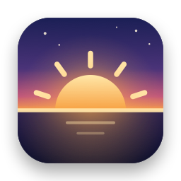
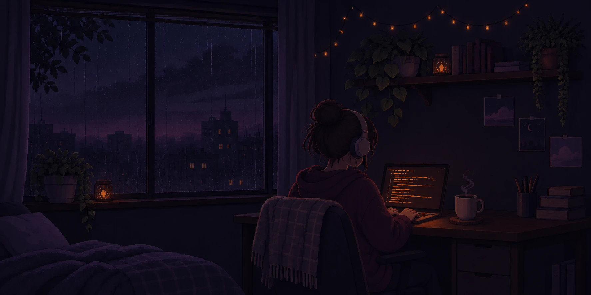

<p align="center">
  
</p>

<h1 align="center">Dusk</h1>

<p align="center">A menu bar screen filter for working comfortably on a Mac at night.<br>
Scroll over the icon to warm and dim the screen.</p>

<p align="center"></p>

## Download

Get the latest notarized build from [Releases](https://github.com/ahmadtawakol/Dusk/releases/latest), unzip it, and move **Dusk.app** to Applications. It runs on macOS 13 or later, on Apple silicon and Intel.

Dusk keeps itself up to date. It checks for a new version once a day and downloads it quietly in the background, then installs it the next time the filter is off or at 0% (or when Dusk quits), so the screen never flashes bright at night. Turn off **Install Updates Automatically** in the menu to be asked first instead; **Check for Updates…** checks right away.

## Features

- **Scroll to adjust.** Put the pointer over the sun in the menu bar and scroll up for a stronger filter, down for a weaker one. A small bubble under the icon shows the level, and the menu bar never shifts.
- **Warm and dim in one control.** Intensity runs from 0% (no tint, your normal brightness) to 100% (your chosen colour at a very low brightness).
- **Max Warmth.** Choose what 100% looks like, from a little warmer through amber and orange to **pure red** (green and blue fully off).
- **Real backlight dimming.** On the built-in screen Dusk lowers the actual backlight instead of darkening pixels, so XDR mini-LED screens don't show a patchy glow around bright things.
- **Works with your brightness keys.** Changing the brightness with the keyboard, Control Center or auto-brightness moves Dusk's intensity to match, and scrolling carries on from there. Switching the screen off with the keys doesn't turn Dusk off.
- **Puts things back.** Turn Off, Quit or `killall Dusk` restore your normal colours and brightness. Your normal brightness is saved to disk, so even a crash can't leave the screen stuck dim.
- **Trackpad ticks** every 5% while scrolling, like the notches of a dial (Force Touch trackpads).
- **Start at login**, toggled from the menu.
- **Silent automatic updates**, signed and checked before they're installed, timed so they never interrupt the filter.

## Using it

| Action | What it does |
| --- | --- |
| Scroll up / down over the icon | Intensity up / down: 5% per mouse-wheel notch, smooth on a trackpad. Follows the direction your fingers or wheel move, whatever your natural-scrolling setting. |
| Click the icon | Opens the menu: Turn Off / Turn On, Intensity slider, Max Warmth slider, Start at Login, Check for Updates, Install Updates Automatically, Quit. |
| Brightness keys | Move the intensity along with the brightness while Dusk is on. |

The icon is filled while Dusk is on (including at 0%) and outlined when it's turned off.

## Building from source

Requires Xcode (for universal builds). The first build fetches [Sparkle](https://sparkle-project.org), the update framework, through Swift Package Manager.

```bash
./build.sh
```

That builds `build/Dusk.app` (universal, signed ad-hoc for your own Mac). Copy it to `/Applications` and open it:

```bash
ditto build/Dusk.app /Applications/Dusk.app && open /Applications/Dusk.app
```

To update an installed copy, quit Dusk first, then run the same two commands. The first launch registers Dusk to start at login; you can turn that off from the menu or in System Settings → General → Login Items.

To redraw the app icon after editing [Tools/make-icon.swift](Tools/make-icon.swift):

```bash
swift Tools/make-icon.swift Resources/AppIcon.icns
```

## How it works

- **Colour** is applied through each display's gamma table (`CGSetDisplayTransferByTable`), scaling the display's own calibrated table. That keeps colour calibration intact, filters the cursor too, and doesn't show up in screenshots or screen sharing. macOS restores the original tables by itself when Dusk exits, even if it crashes, and Dusk re-applies its tables if macOS resets them (after sleep or a display change).
- **Brightness** on the built-in screen is set through the private `DisplayServices` framework, the same one the brightness keys use. At 100% the backlight goes down to 5% of your normal brightness, never below 1.5% so the screen can't switch off. External displays, whose backlight Dusk can't control, are dimmed through the gamma table instead.
- **Scrolling** is picked up with a global event monitor. On current macOS, menu bar icons are drawn by another process, so scrolls over the icon never reach the app that owns it.
- **Updates** come through [Sparkle](https://sparkle-project.org). Each release's zip is signed with an EdDSA key, and Sparkle only installs an update whose signature matches the public key built into the app.

All the tuning values (the Max Warmth colour stops, how dark 100% gets, scroll speed) are constants at the top of [Sources/Dusk/main.swift](Sources/Dusk/main.swift). Settings are stored in the `local.dusk` defaults domain.

## Limitations

- `DisplayServices` is private. A future macOS update could break the backlight control; the colour filter would keep working.
- Dimming via the gamma table (external displays) reduces contrast more than real backlight dimming does.
